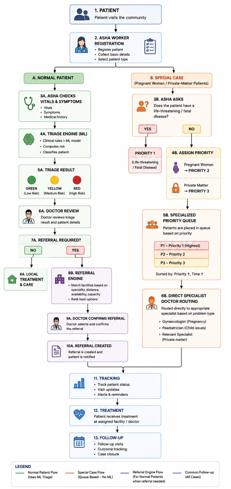

<div align="center">

# 🏥 SIH Healthcare Platform

**AI-assisted triage, priority queuing and smart referrals for rural and underserved communities**

Smart India Hackathon 2026


</div>

---

## 📌 Table of Contents

1. [Problem Statement](#-problem-statement)
2. [Our Solution](#-our-solution)
3. [Key Features](#-key-features)
4. [System Architecture](#-system-architecture)
5. [Workflow in Detail](#-workflow-in-detail)
6. [Tech Stack](#-tech-stack)
7. [Project Structure](#-project-structure)
8. [Getting Started](#-getting-started)
9. [Environment Variables](#-environment-variables)
10. [API Overview](#-api-overview)
11. [Roadmap](#-roadmap)
12. [Team](#-team)
13. [License](#-license)

---

## 🎯 Problem Statement

In rural and underserved areas, patients often struggle to reach the right doctor at the right time. Community health workers (ASHA workers) are the first point of contact, but they lack tools to:

- Quickly judge how serious a patient's condition is
- Decide whether a patient needs to be referred
- Choose a suitable facility based on specialty, distance and availability
- Track a patient after referral

This leads to delayed treatment, overcrowded facilities, and missed follow-ups.

## 💡 Our Solution

A digital platform that supports the full patient journey, from registration by an ASHA worker to follow-up after treatment:

- An **ML-based triage engine** classifies normal patients as Green, Yellow or Red risk.
- A **priority queue** handles special cases (pregnant women, private-matter patients, life-threatening cases) without ML, so sensitive cases are routed predictably and quickly.
- A **referral engine** ranks facilities by specialty, distance, availability and capacity.
- **Tracking and follow-up** keep every patient visible until case closure.

## ✨ Key Features

| Feature | Description |
|---|---|
| 👩‍⚕️ ASHA Registration | Register patients, collect basic details and select patient type |
| 🧠 ML Triage | Clinical rules plus an ML model compute risk and classify patients |
| 🚦 Risk Classification | Green (low), Yellow (medium), Red (high) |
| 🤰 Special Case Queue | Separate priority queue for pregnant women and private-matter patients |
| 🚨 Life-threatening Fast Track | Fatal or life-threatening cases are assigned Priority 1 immediately |
| 🏥 Referral Engine | Matches and ranks facilities by specialty, distance, availability and capacity |
| 👨‍⚕️ Doctor Confirmation | A doctor always reviews triage and confirms referrals |
| 🩺 Direct Specialist Routing | Gynaecologist, Paediatrician or relevant specialist based on problem type |
| 📊 Tracking | Patient status, visit updates, alerts and reminders |
| 🔁 Follow-up | Follow-up visits, outcome tracking and case closure |

## 🏗 System Architecture

> 📷 Save your architecture diagram as `docs/architecture.png` so it renders below.



The system has three flows that merge into common tracking and follow-up:

- 🟢 **Normal Patient Flow** uses ML triage.
- 🟠 **Special Case Flow** is queue based, with no ML.
- 🟣 **Referral Engine Flow** applies to normal patients when a referral is needed.
- 🔵 **Common Follow-up** applies to all cases.

## 🔄 Workflow in Detail

### Common entry

1. **Patient** visits the community.
2. **ASHA worker registration**: registers the patient, collects basic details and selects the patient type (Normal or Special Case).

### 🟢 A. Normal Patient Flow (ML triage)

| Step | Description |
|---|---|
| 3A | ASHA checks vitals, symptoms and medical history |
| 4A | **Triage Engine (ML)** combines clinical rules and an ML model, computes risk and classifies the patient |
| 5A | **Triage result**: 🟢 Green (low), 🟡 Yellow (medium), 🔴 Red (high) |
| 6A | **Doctor review** of the triage result and patient details |
| 7A | **Referral required?** |
| 8A | If **No**: local treatment and care |
| 8B | If **Yes**: **Referral Engine** matches facilities by specialty, distance, availability and capacity, and ranks the best options |
| 9A | **Doctor confirms referral** by selecting from the ranked options |
| 10A | **Referral created** and the patient is notified |

### 🟠 B. Special Case Flow (queue based, no ML)

For **pregnant women** and **private-matter patients**.

| Step | Description |
|---|---|
| 3B | ASHA asks: does the patient have a life-threatening or fatal disease? |
| Yes | **Priority 1**: life-threatening or fatal disease |
| No (4B) | **Pregnant women → Priority 2**, **Private matter → Priority 3** |
| 5B | **Specialized priority queue**, sorted by priority (ascending) then time (ascending) |
| 6B | **Direct specialist routing**: Gynaecologist (pregnancy), Paediatrician (child issues), Relevant specialist (private matter) |

### 🔵 Common Follow-up (all cases)

| Step | Description |
|---|---|
| 11 | **Tracking**: patient status, visit updates, alerts and reminders |
| 12 | **Treatment** at the assigned facility or doctor |
| 13 | **Follow-up**: follow-up visits, outcome tracking, case closure |

## 🛠 Tech Stack

| Layer | Technology |
|---|---|
| Frontend | React, Vite, Tailwind CSS |
| Backend | FastAPI (Python) |
| Database | Supabase (PostgreSQL) |
| Machine Learning | Triage model and referral ranking engine (Python) |
| Docs | Markdown, architecture diagrams |

## 📁 Project Structure

```
sih-healthcare-platform/
├── frontend/        # React + Vite + Tailwind application
├── backend/         # FastAPI backend (REST APIs)
├── database/        # Database schema and seed data
├── ml/              # Triage model and referral engine integration
├── docs/            # Architecture diagram and API documentation
├── .gitignore
└── README.md
```

## 🚀 Getting Started

### Prerequisites

- [Node.js](https://nodejs.org/) 18 or later
- [Python](https://www.python.org/) 3.10 or later
- A [Supabase](https://supabase.com/) project
- Git

### 1. Clone the repository

```bash
git clone https://github.com/so-shaurya/sih-healthcare-platform.git
cd sih-healthcare-platform
```

### 2. Set up the database

1. Create a new project on Supabase.
2. Open the SQL editor and run the schema from `database/` (then the seed data, if provided).
3. Copy your project URL and keys for the environment variables below.

### 3. Run the backend

```bash
cd backend
python -m venv venv

# Windows
venv\Scripts\activate
# macOS / Linux
source venv/bin/activate

pip install -r requirements.txt
cp .env.example .env        # then fill in your values
uvicorn main:app --reload
```

The API runs at `http://localhost:8000`, with interactive docs at `http://localhost:8000/docs`.

### 4. Run the frontend

```bash
cd frontend
npm install
cp .env.example .env        # then fill in your values
npm run dev
```

The app runs at `http://localhost:5173`.

> Adjust file names and commands (for example `main:app`) if your project uses different ones.

## 🔐 Environment Variables

**backend/.env**

```env
SUPABASE_URL=your_supabase_project_url
SUPABASE_KEY=your_supabase_service_key
```

**frontend/.env**

```env
VITE_API_URL=http://localhost:8000
VITE_SUPABASE_URL=your_supabase_project_url
VITE_SUPABASE_ANON_KEY=your_supabase_anon_key
```

> ⚠️ Never commit `.env` files. Commit only `.env.example` with placeholder values.

## 📡 API Overview

Planned endpoints (update to match your implementation):

| Method | Endpoint | Purpose |
|---|---|---|
| POST | `/patients` | Register a patient |
| POST | `/triage` | Run ML triage and return Green / Yellow / Red |
| POST | `/special-cases` | Register a special case and assign priority |
| GET | `/queue` | Get the specialized priority queue |
| POST | `/referrals/recommend` | Get ranked facility recommendations |
| POST | `/referrals` | Doctor confirms and creates a referral |
| GET | `/patients/{id}/status` | Track patient status |
| POST | `/followups` | Record a follow-up visit and outcome |

## 🗺 Roadmap

- [x] System architecture and workflow design
- [ ] ASHA registration and patient intake
- [ ] ML triage model integration
- [ ] Special case priority queue
- [ ] Referral engine with facility ranking
- [ ] Doctor dashboard
- [ ] Tracking, alerts and reminders
- [ ] Multilingual and offline-first support
- [ ] Deployment (frontend, backend, database)

## 👥 Team

| Name | Role | GitHub |
|---|---|---|
| Shaurya | Developer | [@so-shaurya](https://github.com/so-shaurya) |
| _Add teammate_ | _Role_ | _link_ |

## 📄 License

This project is licensed under the MIT License. See the `LICENSE` file for details.

---

<div align="center">
Built for Smart India Hackathon 2026
</div>
